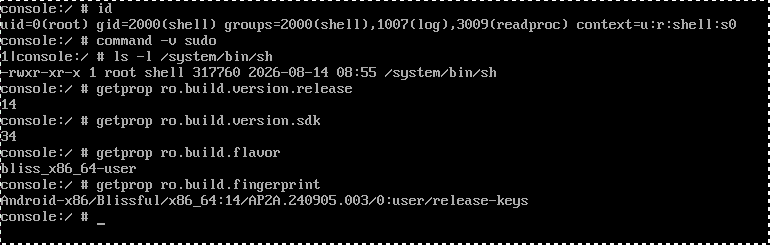
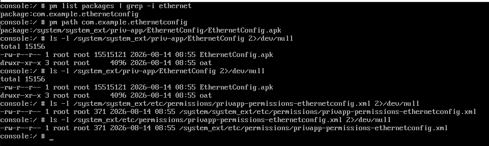
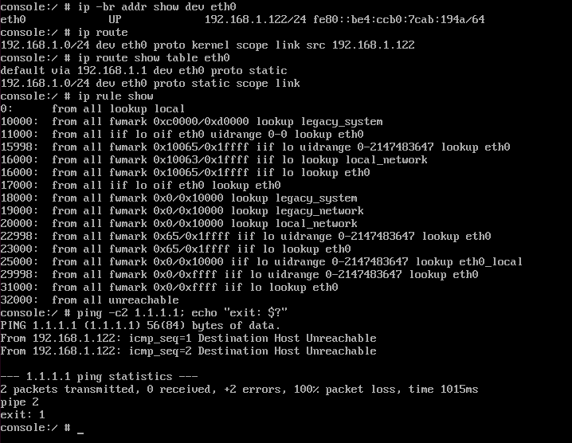
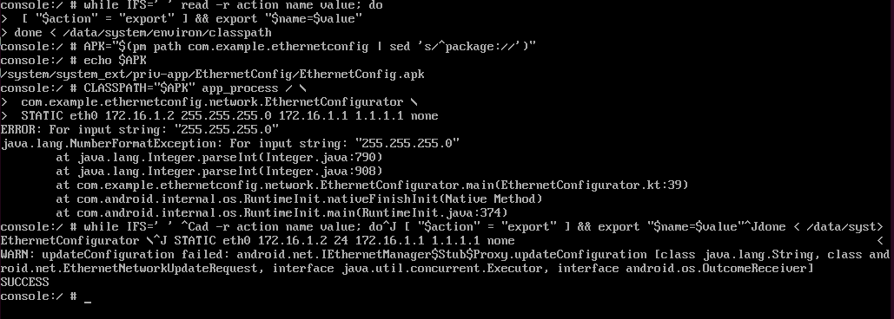
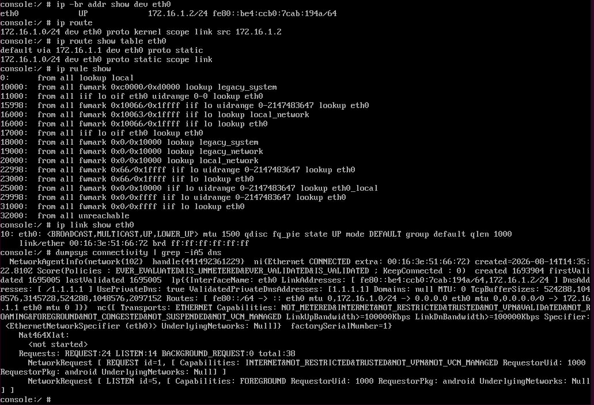
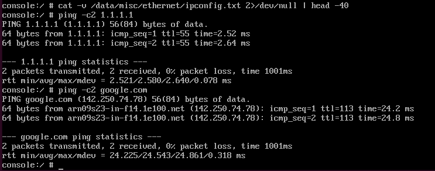
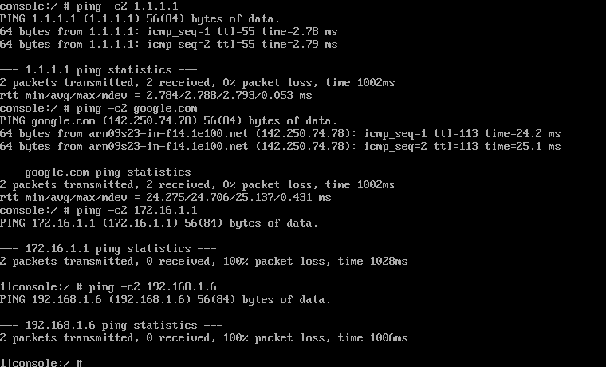
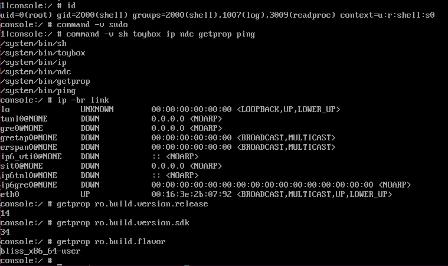
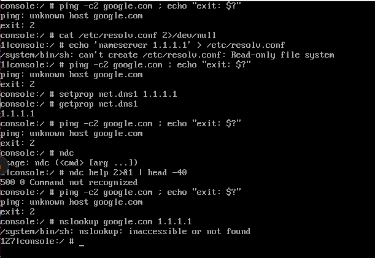
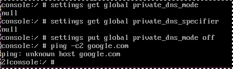

# Runbook — Android clone isolation and connectivity parity (DRAFT-013)

> **Issue:** DRAFT-013 — published as
> [#13](https://github.com/evilbootloader/drakvuf-multios-sandbox/issues/13).
>
> **Status: EXECUTED 2026-08-14 against the EthernetConfig image. PASS on
> both halves.** This is now an execution transcript and is **append-only** —
> annotate, never edit.
>
> - **Android tolerates the isolation posture.** It probed the gateway, was
>   refused (10 packets dropped by `DRAKVUF_INPUT`), and still validated the
>   network. No rule change is needed; NET-02 stays closed.
> - **EthernetConfig subsumes the entire `ip` chain.** The five commands the
>   old image needed collapse to one framework call — address, link, both
>   routing tables and DNS. `preconfig-android.sh` is three commands, written
>   out under "The `preconfig-android.sh` specification".
>
> Four findings (F1–F4) and one defect in this runbook's own step 5 gate are
> recorded at the end. **Read F3 before writing DRAFT-016** — without
> `private_dns_mode off`, Android analysis silently loses DNS visibility.
>
> **The 2026-08-12 measurements are not lost.** They were taken against an
> image that no longer exists and are preserved verbatim in **Appendix A**.
> They remain evidence, and DRAFT-013 requires them: "candidate resolver
> mechanisms that did **not** work are recorded too" is an acceptance
> criterion, not a courtesy.

## What changed, and why this runbook was redone

The 2026-08-12 run got as far as step 7 and stopped on a genuine dead end:
**this Android 14 build had no shell command that could set the Ethernet
resolver.** `/etc/resolv.conf` was a no-op, `setprop net.dns1` was a no-op,
`ndc resolver` did not exist, and `cmd ethernet help` returned
`No shell command implementation.` That is not a search failure — Android 14
moved resolver configuration behind binder (`IDnsResolver`) with no shell
client.

`preconfig-android.sh` cannot click a UI, so the remaining options were both
bad: bake a resolver into the golden image (reversing issue #7), or add a
Dom0-side DNS redirect (reopening part of the containment posture DRAFT-029
closed).

**BlissOS was rebuilt instead**, integrating Bliss-Bass EthernetConfig as a
platform-signed privileged app — `docs/android_setup_good.md`. It ships a
standalone `main()` that reaches `IEthernetManager` directly and sets
address, prefix, gateway **and DNS** in one call. That is the framework's own
path, not a workaround.

So this runbook now measures a different thing at step 6. **The isolation
half is unchanged and still unmeasured** — the rules match on interface, not
on the guest, so the prediction below carries over verbatim.

## What this establishes

Three things now, and the third is new:

1. **Does Android tolerate the isolation rules?** It runs active connectivity
   validation and can mark a network unusable; the containment posture
   deliberately makes the gateway unresponsive to everything except replies
   to Dom0-initiated traffic. **Unchanged since 2026-08-12, still open.**
2. **Does the EthernetConfig path work on a clone**, not just on the golden
   VM where it was partially validated on 2026-08-14?
3. **How much of the manual `ip` chain does it subsume?** This decides
   whether `preconfig-android.sh` is one command or six.

**The prediction is that Android passes.** ARP/NUD to the gateway is L2 and
unfiltered by `iptables`, Android's validation probes go to the Internet
rather than to the gateway, and the resolver is a public address forwarded
through Dom0 rather than served by it. Recording the prediction in advance is
deliberate: a test written to confirm what it expects is worth much less than
one that can fail. **If Android passes, say so plainly. If it fails, that is
the more interesting result and the fix is a separate issue.**

## Read this before you start

**No sample runs. This is a boot test.** Benign, no malware, nothing from
`/malware_incoming`.

**Never restore onto the golden or the template LV.** Always a snapshot —
the same rule `rebuild-android-sandbox.md` step 7 states, and step 11 here
re-checks it.

**The vif must attach to `xenbr1.<vlan>`, not `xenbr1`.** This is the trap
that would silently invalidate the whole exercise. The isolation rules match
the `xenbr1.+` wildcard, which matches `xenbr1.1`, `xenbr1.2` and so on and
**deliberately does not match the bare bridge**
(`automation/network-setup.sh:369-372`). `misc/android_sandbox.cfg` ships
`bridge=xenbr1`, and `rebuild-android-sandbox.md` step 7's throwaway config
inherits it — so a config built by copying that one attaches an Android guest
to an **unfiltered** bridge. Step 3 below checks the attachment before the
guest is unpaused, and that check is not optional.

**Expect Android to reach the Internet during this test.** Its validation
probes are how it decides the network works. The traffic is benign — Google
connectivity checks — but note that an Android clone generates identifiable
outbound traffic at boot, before any sample runs, on a residential uplink
(roadmap risk #13). That is an input to DRAFT-022 and to the `offline` mode.

Guest access is **VNC only**; there is no `adb` on this build. The console is
launched from the root serial console (`androidboot.enable_console=1`), so
the guest shell is already root and there is **no `sudo` binary** — every
`sudo` in the Ubuntu chain is dropped, not translated. The same reasoning
drops upstream EthernetConfig's `su -c`.

**This image is `userdebug`, where the old one was `user`.** Two step-0
values change because of that, by design and not by corruption — see step 0.

---

## Step 0 — Preconditions

```bash
uptime
xl list                                   # expect: no clone domains
git -C /root/sandbox_project branch --show-current    # expect: master
git -C /root/sandbox_project log -1 --oneline
git -C /root/sandbox_project status --porcelain       # expect: empty

sudo lvs -a -o lv_name,lv_size vg-root
sudo blockdev --getsize64 /dev/vg-root/android        # golden, for step 11
ls -l /root/sandbox_project/state/android_sandbox.bak
sha256sum /root/sandbox_project/state/android_sandbox.bak
```

> **The expected checksum is NOT `1844fc0a…` any more.** That value belongs to
> the pre-EthernetConfig template. The rebuilt template has a new one, and a
> mismatch here is the expected result rather than a sign of corruption.
> **Record the new value and treat it as the baseline from now on**, including
> in `rebuild-android-sandbox.md`.
>
> Likewise the **anchor PID is no longer 3163** unless the rebuild happened to
> reproduce it. Read it from the new template's rebuild transcript, not from
> memory.

The template must have been rebuilt from the new golden image before this
runs — `docs/android_setup_good.md` §25, via
`docs/runbooks/rebuild-android-sandbox.md`. A clone restored from the old
`.bak` runs the old kernel and has no EthernetConfig in it.

```text
root@drakvuf:~# uptime
 16:03:33 up  1:23,  2 users,  load average: 0,05, 0,01, 0,00
root@drakvuf:~# xl list
Name                                        ID   Mem VCPUs	State	Time(s)
Domain-0                                     0  4096     4     r-----      56.0
root@drakvuf:~# git -C /root/sandbox_project branch --show-current
master
root@drakvuf:~# git -C /root/sandbox_project log -1 --oneline
aed37af (HEAD -> master, origin/master, origin/HEAD) Merge pull request #10 from evilbootloader/draft-029-terminal-chains
root@drakvuf:~# git -C /root/sandbox_project status --porcelain       # expect: empty
 M misc/android.cfg
?? misc/android.json
root@drakvuf:~# sudo lvs -a -o lv_name,lv_size vg-root
  LV                     LSize  
  android                 32,00g
  android_sandbox         32,00g
  lv-root                256,00g
  ubuntu                  64,00g
  ubuntu_sandbox          64,00g
  ubuntu_sandbox-1-clone  64,00g
root@drakvuf:~# sudo blockdev --getsize64 /dev/vg-root/android        # golden, for step 11
34359738368
root@drakvuf:~# ls -l /root/sandbox_project/state/android_sandbox.bak
-rw-r--r-- 1 root root 2139603376 ago 14 16:08 /root/sandbox_project/state/android_sandbox.bak
root@drakvuf:~# sha256sum /root/sandbox_project/state/android_sandbox.bak
516644e223327d5ae5aa17c568240c00127b8d8b88915e70131acf0cd192677c  /root/sandbox_project/state/android_sandbox.bak


Golden LV size: 34359738368
NEW saved-state checksum: 516644e223327d5ae5aa17c568240c00127b8d8b88915e70131acf0cd192677c
NEW anchor PID: 3164
Template rebuilt from the EthernetConfig image?   yes
```

## Step 1 — Provision and verify the analysis network

```bash
sudo /root/sandbox_project/automation/network-setup.sh 2
echo "exit: $?"

sudo nft list chain ip filter DRAKVUF_ISOLATION    # expect 9 rules
sudo nft list chain ip filter DRAKVUF_INPUT        # expect 2 rules
sudo nft list chain ip6 filter DRAKVUF_ISOLATION6  # expect 2 rules
ip -br addr show | grep xenbr1
```

Unchanged from 2026-08-12, and it passed then — see Appendix A step 1 for the
expected shape of the output.

```text
root@drakvuf:~# sudo /root/sandbox_project/automation/network-setup.sh 2
network-setup.sh: provisioned 2 VLAN sub-interface(s) on xenbr1
root@drakvuf:~# echo "exit: $?"

sudo nft list chain ip filter DRAKVUF_ISOLATION    # expect 9 rules
sudo nft list chain ip filter DRAKVUF_INPUT        # expect 2 rules
sudo nft list chain ip6 filter DRAKVUF_ISOLATION6  # expect 2 rules
ip -br addr show | grep xenbr1
exit: 0
table ip filter {
	chain DRAKVUF_ISOLATION {
		iifname "xenbr1.*" oifname != "xenbr0" counter packets 0 bytes 0 drop
		iifname "xenbr1.*" ip daddr 10.0.0.0/8 counter packets 0 bytes 0 drop
		iifname "xenbr1.*" ip daddr 172.16.0.0/12 counter packets 0 bytes 0 drop
		iifname "xenbr1.*" ip daddr 192.168.0.0/16 counter packets 0 bytes 0 drop
		iifname "xenbr1.*" ip daddr 169.254.0.0/16 counter packets 0 bytes 0 drop
		iifname "xenbr1.*" oifname "xenbr0" counter packets 0 bytes 0 accept
		oifname "xenbr1.*" ct state related,established counter packets 0 bytes 0 accept
		oifname "xenbr1.*" counter packets 0 bytes 0 drop
		iifname "xenbr1.*" counter packets 0 bytes 0 drop
	}
}
table ip filter {
	chain DRAKVUF_INPUT {
		iifname "xenbr1.*" ct state related,established counter packets 0 bytes 0 accept
		iifname "xenbr1.*" counter packets 30 bytes 3858 drop
	}
}
table ip6 filter {
	chain DRAKVUF_ISOLATION6 {
		iifname "xenbr1.*" counter packets 0 bytes 0 drop
		oifname "xenbr1.*" counter packets 0 bytes 0 drop
	}
}
xenbr1           UNKNOWN        fe80::d46a:64ff:fea6:1345/64 
xenbr1.1@xenbr1  UP             172.16.1.1/24 fe80::d46a:64ff:fea6:1345/64 
xenbr1.2@xenbr1  UP             172.16.2.1/24 fe80::d46a:64ff:fea6:1345/64 

DRAKVUF_ISOLATION rules (expect 9): 9
DRAKVUF_INPUT rules (expect 2): 2
xenbr1.1 present and addressed 172.16.1.1/24? 172.16.1.1/24
```

## Step 2 — Disposable clone on a snapshot

```bash
sudo lvcreate -s -n android_sandbox-13-clone -L32G /dev/vg-root/android_sandbox
sudo lvs -a -o lv_name,lv_size,origin vg-root | grep 13-clone
```

Write `/root/android_isolation_test.cfg` as a copy of
`misc/android_sandbox.cfg` with **three** changes:

```python
name = "android_isolation_test"
disk = [ 'phy:/dev/vg-root/android_sandbox-13-clone,hda,w' ]
vif  = [ 'type=ioemu,model=e1000,script=vif-openvswitch,bridge=xenbr1.1' ]
#                                                              ^^^^^^^^
#  NOT bridge=xenbr1. See "Read this before you start".
```

> **Keep the domain name and the config's `name =` in agreement.** On
> 2026-08-12 the config said `android_sandbox_test` while the runbook drove
> `android_isolation_test`, and `xl network-list android_isolation_test`
> returned `invalid domain identifier (rc=-6)` before the operator noticed.
> Harmless there, but the same slip in an automated path is a clone that
> never gets checked.

```text
root@drakvuf:~# sudo lvcreate -s -n android_sandbox-13-clone -L32G /dev/vg-root/android_sandbox
  Logical volume "android_sandbox-13-clone" created.
root@drakvuf:~# sudo lvs -a -o lv_name,lv_size,origin vg-root | grep 13-clone
  android_sandbox-13-clone  32,00g android_sandbox
root@drakvuf:~# cat android_isolation_test.cfg  | grep -E "vif =|disk =|name ="
name = "android_isolation_test"
vif = [ 'type=ioemu,model=e1000,script=vif-openvswitch,bridge=xenbr1.1' ]
disk = [ 'phy:/dev/vg-root/android_sandbox-13-clone,hda,w' ]

Snapshot created? Yes
Domain name in the cfg: android_isolation_test
vif line as written: vif = [ 'type=ioemu,model=e1000,script=vif-openvswitch,bridge=xenbr1.1' ]
```

## Step 3 — Restore paused, and CHECK THE ATTACHMENT

```bash
sudo xl restore -p -e /root/android_isolation_test.cfg \
    /root/sandbox_project/state/android_sandbox.bak
sudo xl list

# The check that makes the rest of this runbook mean anything.
sudo xl network-list <the domain name from step 2>
sudo ovs-vsctl show
ip -br link | grep -i vif
```

**The vif must appear on `xenbr1.1`.** In `ovs-vsctl show` that is the
`tag: 1` on the `vifN.0` ports. If it is on the bare bridge with no tag,
destroy the domain, fix the config and restore again — do not proceed and do
not "check later". A guest on the bare bridge has no isolation rules applied
to it.

```text
root@drakvuf:~# sudo xl restore -p -e /root/android_isolation_test.cfg \
    /root/sandbox_project/state/android_sandbox.bak
Loading new save file /root/sandbox_project/state/android_sandbox.bak (new xl fmt info 0x3/0x0/1448)
 Savefile contains xl domain config in JSON format
Parsing config from /root/android_isolation_test.cfg
xc: info: Found x86 HVM domain from Xen 4.20
xc: info: Restoring domain
xc: info: Restore successful
xc: info: XenStore: mfn 0xfeffc, dom 0, evt 1
xc: info: Console: mfn 0xfefff, dom 0, evt 2
root@drakvuf:~# sudo xl list
Name                                        ID   Mem VCPUs	State	Time(s)
Domain-0                                     0  4096     4     r-----     154.0
android_isolation_test                       3  2032     1     --p---       0.0
root@drakvuf:~# sudo xl network-list android_isolation_test
Idx BE Mac Addr.         handle state evt-ch   tx-/rx-ring-ref BE-path                       
0   0  00:16:3e:22:16:e1     0     1     -1    -1/-1          /local/domain/0/backend/vif/3/0
root@drakvuf:~# sudo ovs-vsctl show
4fa25d31-2afb-46ae-8324-a77c0e1d9111
    Bridge xenbr1
        Port vif3.0-emu
            tag: 1
            Interface vif3.0-emu
        Port xenbr1
            Interface xenbr1
                type: internal
        Port vif3.0
            tag: 1
            Interface vif3.0
    ovs_version: "2.17.9"
root@drakvuf:~# ip -br link | grep -i vif
vif3.0-emu       UNKNOWN        fe:ff:ff:ff:ff:ff <BROADCAST,MULTICAST,UP,LOWER_UP> 
vif3.0           DOWN           fe:ff:ff:ff:ff:ff <NO-CARRIER,BROADCAST,MULTICAST,UP>

vif attached to (must be xenbr1.1 / tag: 1): yes
```

## Step 4 — Capture, zero, unpause

Order matters: capture first, zero second, unpause last, so every counted
packet and every captured frame belongs to this boot.

```bash
sudo tcpdump -ni xenbr1.1 -w /root/draft-013-android-boot.pcap &
sleep 2
sudo iptables -Z DRAKVUF_ISOLATION
sudo iptables -Z DRAKVUF_INPUT
sudo ip6tables -Z DRAKVUF_ISOLATION6
sudo ip6tables -Z DRAKVUF_INPUT6

sudo xl unpause android_isolation_test
sudo xl list
```

```text
root@drakvuf:~# sudo tcpdump -ni xenbr1.1 -w /root/draft-013-android-boot.pcap &
[1] 3385
root@drakvuf:~# tcpdump: listening on xenbr1.1, link-type EN10MB (Ethernet), snapshot length 262144 bytes

root@drakvuf:~# sleep 2
root@drakvuf:~# sudo iptables -Z DRAKVUF_ISOLATION
root@drakvuf:~# sudo iptables -Z DRAKVUF_INPUT
root@drakvuf:~# sudo ip6tables -Z DRAKVUF_ISOLATION6
root@drakvuf:~# sudo ip6tables -Z DRAKVUF_INPUT6
root@drakvuf:~# sudo xl unpause android_isolation_test
root@drakvuf:~# sudo xl list
Name                                        ID   Mem VCPUs	State	Time(s)
Domain-0                                     0  4096     4     r-----     159.1
android_isolation_test                       3  2032     1     -b----       0.8
```

## Step 5 — Establish the guest environment

Over VNC. Everything here is discovery — Ubuntu never had to ask any of it.

```sh
id                                  # expect uid=0; confirms no sudo needed
command -v sudo                     # expect: nothing
ls -l /system/bin/sh
command -v sh mksh toybox ip ndc getprop ping
ip -br link                         # the interface name -- confirm, do not assume

getprop ro.build.version.release
getprop ro.build.version.sdk
getprop ro.build.flavor
getprop ro.build.fingerprint
```

**Confirm this is the new image before anything else.** The fingerprint must
differ from the old one, and the flavour must now say `userdebug`:



```text
old (2026-08-12):
  Android-x86/Blissful/x86_64:14/AP2A.240905.003/0:user/release-keys
                                                  ^^^^ user
```

If the fingerprint is unchanged, the clone came from the old template and
everything below measures the wrong image. Stop and recheck step 0.

> ### ANNOTATION 2026-08-14 — this gate is WRONG. It fired, and it should not have.
>
> The measured fingerprint is **byte-identical** to the 2026-08-12 one, and
> the flavour reads `bliss_x86_64-user`, not `userdebug`. By the paragraph
> above, the operator should have stopped. **Continuing was correct**, and the
> gate is the defect:
>
> - Step 5b found EthernetConfig at
>   `/system/system_ext/priv-app/EthernetConfig/EthernetConfig.apk`, and
>   step 6b ran it to `exit 0`. The old image had no EthernetConfig at all —
>   that is the entire reason the ROM was rebuilt. **This is unambiguously
>   the new image.**
> - `ro.build.fingerprint` on Android-x86 is built from `BUILD_ID` plus the
>   product, variant and key type. Rebuilding from the same manifest without
>   bumping `BUILD_ID` reproduces it exactly. It is a *build recipe*
>   identifier, not a build identity.
>
> **The real discriminator is step 5b**, which is cheap, direct, and cannot
> be reproduced by accident. Treat 5b as the gate and the fingerprint as
> informational.
>
> **Separate and still open: the variant is `user`, not `userdebug`.**
> `docs/android_setup_good.md` §4 lunches `bliss_x86_64-ap2a-userdebug`, and
> §26 of that guide asserts the fingerprint changes because of it. The
> deployed image disagrees on both counts. Nothing in this run needed
> `userdebug` — the root console comes from `androidboot.enable_console=1`,
> not from the variant, and `app_process64` ran fine — so **this is not a
> re-test trigger**. It is a discrepancy between the guide and the artefact,
> and one of the two is wrong. Resolve it before the next rebuild.

### Step 5b — EthernetConfig is present and privileged

New, and cheap. Establish that the mechanism step 6 depends on actually
shipped in this image:

```sh
pm list packages | grep -i ethernet
pm path com.example.ethernetconfig

# It must come from the ROM's system_ext, NOT from /data/app -- a sideloaded
# copy is not platform-signed and cannot reach IEthernetManager.
ls -l /system/system_ext/priv-app/EthernetConfig/     2>/dev/null
ls -l /system_ext/priv-app/EthernetConfig/            2>/dev/null
ls -l /system/system_ext/etc/permissions/privapp-permissions-ethernetconfig.xml 2>/dev/null
ls -l /system_ext/etc/permissions/privapp-permissions-ethernetconfig.xml        2>/dev/null
```



```text
PASTE OUTPUT HERE

Running as root? yes
`sudo` present? no
Shell path for execproc: /system/bin/sh
Interface name (Ubuntu: eth0): eth0

Android release / SDK: 34
Build flavour (expect userdebug): blis_x86_64-user
Fingerprint (must differ from the 2026-08-12 one): Android-x86/Blissful/x86_64:14/AP2A.240905.003/0:user/release-keys

EthernetConfig installed? Yes
APK path (expect .../system_ext/priv-app/...): /system/system_ext/priv-app/EthernetConfig/EthernetConfig.apk
privapp permission XML present? Yes
```

## Step 6 — The experiment: EthernetConfig ALONE

**This is the step the rebuild was for, and its design matters more than its
commands.**

The 2026-08-12 run needed five commands to get connectivity, including
`ip route replace … table eth0` — Android's per-network policy routing, which
nothing in the Ubuntu implementation hints at. The open question is how many
of those five EthernetConfig makes unnecessary.

> ### Run EthernetConfig FIRST, with no manual `ip` commands at all.
>
> If you configure the interface by hand and then run EthernetConfig, the
> result is uninterpretable — you cannot tell which mechanism produced the
> working state, and `preconfig-android.sh` gets written against a guess.
> Add manual commands only in step 6d, one at a time, and only if 6c shows
> something missing.

### Step 6a — Baseline: prove nothing is configured yet

```sh
ip -br addr show dev eth0
ip route
ip route show table eth0
ip rule show
ping -c2 1.1.1.1 ; echo "exit: $?"        # expect: fails. This is the point.
```



### Step 6b — Import the ART classpath, then run the helper

**Do not skip the import.** Measured on 2026-08-14
(`docs/android_setup_good.md` §17.2.1): without it `app_process` aborts with
**exit 134** before reaching `EthernetConfigurator.main()`, because the
console environment does not carry the generated ART classpath exports. The
failure looks like a broken helper and is not.

```sh
# Is it already there? (§8.1.2's late-start change is meant to make it so.)
env | grep -E '^(BOOTCLASSPATH|DEX2OATBOOTCLASSPATH|SYSTEMSERVERCLASSPATH)='

# If missing, import it:
while IFS=' ' read -r action name value; do
    [ "$action" = "export" ] && export "$name=$value"
done < /data/system/environ/classpath

env | grep -E '^(BOOTCLASSPATH|DEX2OATBOOTCLASSPATH|SYSTEMSERVERCLASSPATH)='
ls -ld /apex/com.android.art
```

Then the one command this whole rebuild exists for — note
`app_process64`, not `app_process`:

```sh
APK="$(pm path com.example.ethernetconfig | sed 's/^package://')"
echo "$APK"

CLASSPATH="$APK" /system/bin/app_process64 / \
    com.example.ethernetconfig.network.EthernetConfigurator \
    STATIC eth0 172.16.1.2 24 172.16.1.1 1.1.1.1 none
echo "exit: $?"
```



Expect `SUCCESS` on stdout. Arguments are positional:
`STATIC <iface> <ip> <prefix> <gw> <dns1> <dns2>`, with `none` accepted for
the last three.

```text

Classpath already present without the import?   no   
Helper output:
exit status: 0
```

### Step 6c — Measure exactly what it produced

The whole deliverable is in this block. Run it **before** touching `ip`:

```sh
ip -br addr show dev eth0        # did it set the address?
ip route                         # main-table default route?
ip route show table eth0         # THE ONE -- per-network policy route?
ip rule show                     # the fwmark rules that select table eth0
ip link show eth0                # is the link UP without `ip link set up`?

dumpsys connectivity | grep -iA5 dns
cat -v /data/misc/ethernet/ipconfig.txt 2>/dev/null | head -40

ping -c2 1.1.1.1    ; echo "exit: $?"
ping -c2 google.com ; echo "exit: $?"
```




Answer each of these explicitly — every "yes" removes a line from
`preconfig-android.sh`:

```text
PASTE OUTPUT HERE

Address set by the helper?                    yes
Link brought UP by the helper?                yes
Default route in `main`?                      yes
Default route in `table eth0`?                yes
DNS visible in dumpsys?                       yes
/data/misc/ethernet/ipconfig.txt written?     no  
Applied WITHOUT a reboot?                     yes 
                                                  
ping 1.1.1.1 works?                           yes 
ping google.com works?                        yes 
```

### Step 6d — Only if 6c shows something missing

Add the missing pieces **one at a time**, re-testing after each, and record
which were actually needed. The 2026-08-12 sequence, for reference — these
are candidates to add back, not a script to run:

```sh
ip link set eth0 up                                           # (1)
ip addr replace 172.16.1.2/24 dev eth0                        # (2)
ip route replace default via 172.16.1.1 dev eth0              # (3)
ip route replace default via 172.16.1.1 dev eth0 table eth0   # (4)
settings put global private_dns_mode off                      # (5) -> step 7b
```

```text
PASTE OUTPUT HERE

Commands that were still required after EthernetConfig:
Commands EthernetConfig made unnecessary:
```

## Step 7 — Resolver verification

The mechanism question is settled; this is now verification, not discovery.
**Dom0 holds the authoritative answer and you do not have to transcribe it** —
step 10's pcap shows whether a query left the guest and where it went:

| In the pcap | Means |
|---|---|
| No DNS packets at all | The resolver never got set — 6b silently failed |
| Query to `172.16.1.1` | Something still points at the gateway; nothing listens there |
| Query to `1.1.1.1`, answered | The mechanism works |
| Traffic on port 853 instead | Private DNS upgraded it — see step 7b |

In-guest:

```sh
ping -c2 google.com ; echo "exit: $?"
nslookup google.com 1.1.1.1     # if present: bypasses the configured resolver
nslookup google.com             # uses it
```

> **`getent` is absent on this build** (bionic ships no such tool), so
> Ubuntu's verification command has no direct equivalent. `ping <name>` is
> the replacement and is the stronger test: it resolves through
> bionic → `netd`, the same path an application takes, and proves resolution
> *and* reachability where `getent hosts` proved only the former.


```text
nslookup not in machine.

ping google.com:
nslookup via 1.1.1.1 explicitly:
nslookup via the configured resolver:
```

### Step 7b — Private DNS. Check this before trusting any pcap

**EthernetConfig does not touch this, so it is unchanged and still live.**

Android 9 and later default `private_dns_mode` to **`opportunistic`**: the
resolver probes whether the configured DNS server supports DNS-over-TLS on
port 853 and silently upgrades to it when it does. **`1.1.1.1` supports
DoT.** So the likely default behaviour of this guest is to resolve over an
encrypted channel.

That directly contradicts a property this project relies on.
`docs/architecture/networking.md` argues that pointing the guest at a public
resolver "costs no visibility", because "`tcpdump.sh` captures the clone's
entire `xenbr1.<vlan>` sub-interface and DNS is plaintext UDP/53, so every
query and answer is in the per-sample pcap whichever resolver serves it."
**On Android 14 that reasoning does not hold**, and the consequence is an
analysis that records TLS to port 853 instead of the domains a sample looked
up — silently, with nothing failing.

```sh
settings get global private_dns_mode        # expect: opportunistic / off / hostname
settings get global private_dns_specifier

# If it is opportunistic, force plaintext and re-test:
settings put global private_dns_mode off
ping -c2 google.com
```

**If port 853 carries traffic, that is a finding for DRAFT-016 and for
`networking.md`, not a curiosity.** Options are forcing
`private_dns_mode=off` per clone, or blocking 853 outbound so the
opportunistic probe fails and Android falls back to plaintext. The second is
a `network-setup.sh` change affecting all three OS families and belongs in
its own issue.

```text
private_dns_mode (default): null
private_dns_specifier: null
Port 853 traffic present in the pcap?   in tcp
Plaintext 53 present?                   yes
Did forcing `off` change it? yes
```

## Step 8 — Connectivity, the same four probes Ubuntu passed

```sh
ping -c2 1.1.1.1              # Internet by IP      expect: replies
ping -c2 google.com           # name resolution     expect: resolves + replies
ping -c2 172.16.1.1           # gateway             expect: 100% loss, by design
ping -c2 <a LAN host>         # LAN                 expect: 100% loss, by design
```

The last two failing is the containment posture working, not a fault.



```text
ping 1.1.1.1: yes
ping google.com: yes
ping gateway (expect fail): no
ping LAN host (expect fail): no
```

## Step 9 — Android's own verdict

From the UI, verbatim. **This is the half of DRAFT-013 that EthernetConfig
does not touch**, and it is still the open containment question.

```text
Network status Android reports: Internet through Ethernet
Any "no internet" / "sign in to network" notification? No
Does a browser load a public page? yes
How long after configuration did the verdict settle?
IPv6: any address obtained? any visible complaint? 
```

## Step 10 — What Android actually did

The Dom0-side record. This is the evidence that does not depend on
transcribing anything from a console with no clipboard.

```bash
sudo kill %1                                   # stop tcpdump

sudo iptables  -vnL DRAKVUF_ISOLATION --line-numbers
sudo iptables  -vnL DRAKVUF_INPUT     --line-numbers
sudo ip6tables -vnL DRAKVUF_ISOLATION6 --line-numbers
sudo ip6tables -vnL DRAKVUF_INPUT6     --line-numbers

tcpdump -nr /root/draft-013-android-boot.pcap arp | head -20
tcpdump -nr /root/draft-013-android-boot.pcap icmp | head -20
tcpdump -nr /root/draft-013-android-boot.pcap port 53 | head -20
tcpdump -nr /root/draft-013-android-boot.pcap port 853 | head -20   # DoT (step 7b)
tcpdump -nr /root/draft-013-android-boot.pcap 'dst host 172.16.1.1' | head -20
tcpdump -nr /root/draft-013-android-boot.pcap 'ip6' | head -20
tcpdump -nr /root/draft-013-android-boot.pcap -c 40
```

**`DRAKVUF_INPUT`'s counter is the number to read first.** It counts what
Android sent to the gateway and had dropped:

- **Zero** — Android never probed the gateway. The posture is irrelevant to
  it.
- **Non-zero, and the network still validated** — Android probed, was
  refused, and did not care. The most useful result: the posture is robust
  rather than lucky.
- **Non-zero, and the network did not validate** — the prediction failed.
  Identify from the pcap exactly what it wanted, and stop; the fix is a
  separate issue because exempting it reopens part of NET-02 for all three
  OS families.

```text
root@drakvuf:~# sudo iptables  -vnL DRAKVUF_ISOLATION --line-numbers
Chain DRAKVUF_ISOLATION (1 references)
num   pkts bytes target     prot opt in     out     source               destination         
1        0     0 DROP       all  --  xenbr1.+ !xenbr0  0.0.0.0/0            0.0.0.0/0           
2        0     0 DROP       all  --  xenbr1.+ *       0.0.0.0/0            10.0.0.0/8          
3        0     0 DROP       all  --  xenbr1.+ *       0.0.0.0/0            172.16.0.0/12       
4        2   168 DROP       all  --  xenbr1.+ *       0.0.0.0/0            192.168.0.0/16      
5        0     0 DROP       all  --  xenbr1.+ *       0.0.0.0/0            169.254.0.0/16      
6      379 67651 ACCEPT     all  --  xenbr1.+ xenbr0  0.0.0.0/0            0.0.0.0/0           
7      409  398K ACCEPT     all  --  *      xenbr1.+  0.0.0.0/0            0.0.0.0/0            ctstate RELATED,ESTABLISHED
8        0     0 DROP       all  --  *      xenbr1.+  0.0.0.0/0            0.0.0.0/0           
9        0     0 DROP       all  --  xenbr1.+ *       0.0.0.0/0            0.0.0.0/0           
root@drakvuf:~# sudo iptables  -vnL DRAKVUF_INPUT     --line-numbers
Chain DRAKVUF_INPUT (1 references)
num   pkts bytes target     prot opt in     out     source               destination         
1        0     0 ACCEPT     all  --  xenbr1.+ *       0.0.0.0/0            0.0.0.0/0            ctstate RELATED,ESTABLISHED
2       10   752 DROP       all  --  xenbr1.+ *       0.0.0.0/0            0.0.0.0/0           
root@drakvuf:~# sudo ip6tables -vnL DRAKVUF_ISOLATION6 --line-numbers
Chain DRAKVUF_ISOLATION6 (1 references)
num   pkts bytes target     prot opt in     out     source               destination         
1        0     0 DROP       all      xenbr1.+ *       ::/0                 ::/0                
2        0     0 DROP       all      *      xenbr1.+  ::/0                 ::/0                
root@drakvuf:~# sudo ip6tables -vnL DRAKVUF_INPUT6     --line-numbers
Chain DRAKVUF_INPUT6 (1 references)
num   pkts bytes target     prot opt in     out     source               destination         
1        8   744 DROP       all      xenbr1.+ *       ::/0                 ::/0                
root@drakvuf:~# tcpdump -nr /root/draft-013-android-boot.pcap arp | head -20
reading from file /root/draft-013-android-boot.pcap, link-type EN10MB (Ethernet), snapshot length 262144
16:14:37.056717 ARP, Request who-has 192.168.1.1 tell 192.168.1.122, length 46
16:14:37.099678 ARP, Request who-has 192.168.1.1 tell 192.168.1.122, length 46
16:14:37.854994 ARP, Request who-has 192.168.1.1 tell 192.168.1.122, length 46
16:14:38.622938 ARP, Request who-has 192.168.1.1 tell 192.168.1.122, length 46
16:14:39.390763 ARP, Request who-has 192.168.1.1 tell 192.168.1.122, length 46
16:14:40.158733 ARP, Request who-has 192.168.1.1 tell 192.168.1.122, length 46
16:14:40.927059 ARP, Request who-has 192.168.1.1 tell 192.168.1.122, length 46
16:14:42.123129 ARP, Request who-has 192.168.1.1 tell 192.168.1.122, length 46
16:14:42.879032 ARP, Request who-has 192.168.1.1 tell 192.168.1.122, length 46
16:14:43.646750 ARP, Request who-has 192.168.1.1 tell 192.168.1.122, length 46
16:14:47.129136 ARP, Request who-has 192.168.1.1 tell 192.168.1.122, length 46
16:14:47.902707 ARP, Request who-has 192.168.1.1 tell 192.168.1.122, length 46
16:14:48.671077 ARP, Request who-has 192.168.1.1 tell 192.168.1.122, length 46
16:14:52.135056 ARP, Request who-has 192.168.1.1 tell 192.168.1.122, length 46
16:14:52.895080 ARP, Request who-has 192.168.1.1 tell 192.168.1.122, length 46
16:14:53.662999 ARP, Request who-has 192.168.1.1 tell 192.168.1.122, length 46
16:14:58.149902 ARP, Request who-has 192.168.1.1 tell 192.168.1.122, length 46
16:14:58.911253 ARP, Request who-has 192.168.1.1 tell 192.168.1.122, length 46
16:14:59.678881 ARP, Request who-has 192.168.1.1 tell 192.168.1.122, length 46
16:15:01.146786 ARP, Request who-has 192.168.1.1 tell 192.168.1.122, length 46
root@drakvuf:~# tcpdump -nr /root/draft-013-android-boot.pcap icmp | head -20
reading from file /root/draft-013-android-boot.pcap, link-type EN10MB (Ethernet), snapshot length 262144
16:38:13.905389 IP 172.16.1.2 > 1.1.1.1: ICMP echo request, id 2, seq 1, length 64
16:38:13.907287 IP 1.1.1.1 > 172.16.1.2: ICMP echo reply, id 2, seq 1, length 64
16:38:14.907527 IP 172.16.1.2 > 1.1.1.1: ICMP echo request, id 2, seq 2, length 64
16:38:14.909299 IP 1.1.1.1 > 172.16.1.2: ICMP echo reply, id 2, seq 2, length 64
16:38:27.212010 IP 172.16.1.2 > 142.250.74.78: ICMP echo request, id 3, seq 1, length 64
16:38:27.235839 IP 142.250.74.78 > 172.16.1.2: ICMP echo reply, id 3, seq 1, length 64
16:38:28.213892 IP 172.16.1.2 > 142.250.74.78: ICMP echo request, id 3, seq 2, length 64
16:38:28.238484 IP 142.250.74.78 > 172.16.1.2: ICMP echo reply, id 3, seq 2, length 64
16:41:08.610256 IP 172.16.1.2 > 142.250.74.78: ICMP echo request, id 4, seq 1, length 64
16:41:08.635487 IP 142.250.74.78 > 172.16.1.2: ICMP echo reply, id 4, seq 1, length 64
16:41:09.611995 IP 172.16.1.2 > 142.250.74.78: ICMP echo request, id 4, seq 2, length 64
16:41:09.635917 IP 142.250.74.78 > 172.16.1.2: ICMP echo reply, id 4, seq 2, length 64
16:43:59.191338 IP 172.16.1.2 > 1.1.1.1: ICMP echo request, id 5, seq 1, length 64
16:43:59.193475 IP 1.1.1.1 > 172.16.1.2: ICMP echo reply, id 5, seq 1, length 64
16:44:00.193347 IP 172.16.1.2 > 1.1.1.1: ICMP echo request, id 5, seq 2, length 64
16:44:00.195492 IP 1.1.1.1 > 172.16.1.2: ICMP echo reply, id 5, seq 2, length 64
16:44:05.108687 IP 172.16.1.2 > 142.250.74.78: ICMP echo request, id 6, seq 1, length 64
16:44:05.132320 IP 142.250.74.78 > 172.16.1.2: ICMP echo reply, id 6, seq 1, length 64
16:44:06.110798 IP 172.16.1.2 > 142.250.74.78: ICMP echo request, id 6, seq 2, length 64
16:44:06.135120 IP 142.250.74.78 > 172.16.1.2: ICMP echo reply, id 6, seq 2, length 64
root@drakvuf:~# tcpdump -nr /root/draft-013-android-boot.pcap port 53 | head -20
reading from file /root/draft-013-android-boot.pcap, link-type EN10MB (Ethernet), snapshot length 262144
16:35:23.810777 IP 172.16.1.2.29918 > 1.1.1.1.53: 35910+ A? connectivitycheck.gstatic.com. (47)
16:35:23.811083 IP 172.16.1.2.64815 > 1.1.1.1.53: 5780+ A? www.google.com. (32)
16:35:23.811133 IP 172.16.1.2.38288 > 1.1.1.1.53: 7951+ A? time.android.com. (34)
16:35:23.813161 IP 1.1.1.1.53 > 172.16.1.2.29918: 35910 1/0/0 A 142.251.208.227 (63)
16:35:23.813535 IP 1.1.1.1.53 > 172.16.1.2.38288: 7951 4/0/0 A 216.239.35.0, A 216.239.35.4, A 216.239.35.12, A 216.239.35.8 (98)
16:35:23.813539 IP 1.1.1.1.53 > 172.16.1.2.64815: 5780 8/0/0 A 142.251.156.119, A 142.251.153.119, A 142.251.150.119, A 142.251.151.119, A 142.251.155.119, A 142.251.154.119, A 142.251.157.119, A 142.251.152.119 (160)
16:35:23.917190 IP 172.16.1.2.32922 > 1.1.1.1.53: 24543+ AAAA? WqVk6n-dnsotls-ds.metric.gstatic.com. (54)
16:35:23.920357 IP 1.1.1.1.53 > 172.16.1.2.32922: 24543 1/0/0 AAAA 2a00:1450:4006:809::2003 (82)
16:41:08.606934 IP 172.16.1.2.18448 > 1.1.1.1.53: 14809+ A? google.com. (28)
16:41:08.609254 IP 1.1.1.1.53 > 172.16.1.2.18448: 14809 1/0/0 A 142.250.74.78 (44)
16:41:08.636255 IP 172.16.1.2.35202 > 1.1.1.1.53: 65517+ PTR? 78.74.250.142.in-addr.arpa. (44)
16:41:08.639514 IP 1.1.1.1.53 > 172.16.1.2.35202: 65517 2/0/0 PTR arn09s23-in-f14.1e100.net., PTR ncmrsa-an-in-f14.1e100.net. (114)
16:46:10.693072 IP 172.16.1.2.7430 > 1.1.1.1.53: 57608+ A? google.com. (28)
16:46:10.695885 IP 1.1.1.1.53 > 172.16.1.2.7430: 57608 1/0/0 A 142.250.74.78 (44)
16:46:10.833346 IP 172.16.1.2.14284 > 1.1.1.1.53: 29631+ A? www.google.com. (32)
16:46:10.861164 IP 1.1.1.1.53 > 172.16.1.2.14284: 29631 8/0/0 A 142.251.155.119, A 142.251.151.119, A 142.251.153.119, A 142.251.150.119, A 142.251.156.119, A 142.251.152.119, A 142.251.154.119, A 142.251.157.119 (160)
16:46:11.397850 IP 172.16.1.2.36017 > 1.1.1.1.53: 51102+ A? fonts.gstatic.com. (35)
16:46:11.400237 IP 1.1.1.1.53 > 172.16.1.2.36017: 51102 1/0/0 A 142.251.208.131 (51)
16:46:12.016727 IP 172.16.1.2.53195 > 1.1.1.1.53: 32643+ A? www.gstatic.com. (33)
16:46:12.019642 IP 1.1.1.1.53 > 172.16.1.2.53195: 32643 1/0/0 A 142.250.181.195 (49)
root@drakvuf:~# tcpdump -nr /root/draft-013-android-boot.pcap port 853 | head -20   # DoT (step 7b)
reading from file /root/draft-013-android-boot.pcap, link-type EN10MB (Ethernet), snapshot length 262144
16:35:23.810620 IP 172.16.1.2.41640 > 1.1.1.1.853: Flags [S], seq 2299661284, win 65535, options [mss 1212,sackOK,TS val 2602638872 ecr 0,nop,wscale 6,tfo  cookiereq,nop,nop], length 0
16:35:23.812802 IP 1.1.1.1.853 > 172.16.1.2.41640: Flags [S.], seq 1189487640, ack 2299661285, win 65535, options [mss 1452,sackOK,TS val 3248146921 ecr 2602638872,nop,wscale 13], length 0
16:35:23.813190 IP 172.16.1.2.41640 > 1.1.1.1.853: Flags [.], ack 1, win 1024, options [nop,nop,TS val 2602639850 ecr 3248146921], length 0
16:35:23.814207 IP 172.16.1.2.41640 > 1.1.1.1.853: Flags [P.], seq 1:229, ack 1, win 1024, options [nop,nop,TS val 2602639851 ecr 3248146921], length 228
16:35:23.816155 IP 1.1.1.1.853 > 172.16.1.2.41640: Flags [.], ack 229, win 16, options [nop,nop,TS val 3248146925 ecr 2602639851], length 0
16:35:23.816160 IP 1.1.1.1.853 > 172.16.1.2.41640: Flags [P.], seq 1:3264, ack 229, win 16, options [nop,nop,TS val 3248146925 ecr 2602639851], length 3263
16:35:23.816456 IP 172.16.1.2.41640 > 1.1.1.1.853: Flags [.], ack 3264, win 1126, options [nop,nop,TS val 2602639854 ecr 3248146925], length 0
16:35:23.842752 IP 172.16.1.2.41640 > 1.1.1.1.853: Flags [P.], seq 229:293, ack 3264, win 1126, options [nop,nop,TS val 2602639880 ecr 3248146925], length 64
16:35:23.886039 IP 1.1.1.1.853 > 172.16.1.2.41640: Flags [.], ack 293, win 16, options [nop,nop,TS val 3248146995 ecr 2602639880], length 0
16:35:23.886167 IP 172.16.1.2.41640 > 1.1.1.1.853: Flags [P.], seq 293:371, ack 3264, win 1126, options [nop,nop,TS val 2602639923 ecr 3248146995], length 78
16:35:23.888238 IP 1.1.1.1.853 > 172.16.1.2.41640: Flags [.], ack 371, win 16, options [nop,nop,TS val 3248146997 ecr 2602639923], length 0
16:35:23.916889 IP 1.1.1.1.853 > 172.16.1.2.41640: Flags [P.], seq 3264:3788, ack 371, win 16, options [nop,nop,TS val 3248147025 ecr 2602639923], length 524
16:35:23.917588 IP 172.16.1.2.41640 > 1.1.1.1.853: Flags [P.], seq 371:449, ack 3788, win 1164, options [nop,nop,TS val 2602639955 ecr 3248147025], length 78
16:35:23.920067 IP 1.1.1.1.853 > 172.16.1.2.41640: Flags [P.], seq 3788:3894, ack 449, win 16, options [nop,nop,TS val 3248147029 ecr 2602639955], length 106
16:35:23.920684 IP 172.16.1.2.41640 > 1.1.1.1.853: Flags [P.], seq 449:473, ack 3894, win 1164, options [nop,nop,TS val 2602639958 ecr 3248147029], length 24
16:35:23.921016 IP 172.16.1.2.41640 > 1.1.1.1.853: Flags [F.], seq 473, ack 3894, win 1164, options [nop,nop,TS val 2602639959 ecr 3248147029], length 0
16:35:23.923267 IP 1.1.1.1.853 > 172.16.1.2.41640: Flags [F.], seq 3894, ack 474, win 16, options [nop,nop,TS val 3248147032 ecr 2602639958], length 0
16:35:23.923397 IP 172.16.1.2.41640 > 1.1.1.1.853: Flags [.], ack 3895, win 1164, options [nop,nop,TS val 2602639961 ecr 3248147032], length 0
16:38:27.157718 IP 172.16.1.2.33704 > 1.1.1.1.853: Flags [S], seq 1549615642, win 65535, options [mss 1212,sackOK,TS val 2602823193 ecr 0,nop,wscale 6,exp-tfo cookiereq], length 0
16:38:27.159799 IP 1.1.1.1.853 > 172.16.1.2.33704: Flags [S.], seq 3873427731, ack 1549615643, win 65535, options [mss 1452,sackOK,TS val 207254278 ecr 2602823193,nop,wscale 13], length 0
root@drakvuf:~# tcpdump -nr /root/draft-013-android-boot.pcap 'dst host 172.16.1.1' | head -20
reading from file /root/draft-013-android-boot.pcap, link-type EN10MB (Ethernet), snapshot length 262144
16:35:22.834445 ARP, Request who-has 172.16.1.1 tell 172.16.1.2, length 46
16:35:23.595547 ARP, Request who-has 172.16.1.1 tell 172.16.1.2, length 46
16:35:28.814851 ARP, Reply 172.16.1.2 is-at 00:16:3e:51:66:72, length 46
16:38:19.311000 ARP, Reply 172.16.1.2 is-at 00:16:3e:51:66:72, length 46
16:41:13.903932 ARP, Reply 172.16.1.2 is-at 00:16:3e:51:66:72, length 46
16:44:04.398978 ARP, Reply 172.16.1.2 is-at 00:16:3e:51:66:72, length 46
16:44:13.932841 IP 172.16.1.2 > 172.16.1.1: ICMP echo request, id 7, seq 1, length 64
16:44:14.961087 IP 172.16.1.2 > 172.16.1.1: ICMP echo request, id 7, seq 2, length 64
16:44:45.105398 ARP, Request who-has 172.16.1.1 tell 172.16.1.2, length 46
16:46:15.983031 ARP, Reply 172.16.1.2 is-at 00:16:3e:51:66:72, length 46
root@drakvuf:~# tcpdump -nr /root/draft-013-android-boot.pcap 'ip6' | head -20
reading from file /root/draft-013-android-boot.pcap, link-type EN10MB (Ethernet), snapshot length 262144
16:14:21.614716 IP6 fe80::d46a:64ff:fea6:1345 > ff02::2: ICMP6, router solicitation, length 16
16:14:37.093268 IP6 :: > ff02::1:ffab:194a: ICMP6, neighbor solicitation, who has fe80::be4:ccb0:7cab:194a, length 32
16:14:37.094897 IP6 :: > ff02::16: HBH ICMP6, multicast listener report v2, 1 group record(s), length 28
16:14:37.134783 IP6 :: > ff02::16: HBH ICMP6, multicast listener report v2, 1 group record(s), length 28
16:14:37.855802 IP6 fe80::be4:ccb0:7cab:194a > ff02::16: HBH ICMP6, multicast listener report v2, 1 group record(s), length 28
16:14:37.856243 IP6 fe80::be4:ccb0:7cab:194a > ff02::2: ICMP6, router solicitation, length 16
16:14:38.131476 IP6 fe80::d46a:64ff:fea6:1345.5353 > ff02::fb.5353: 0 [2q] PTR (QM)? _ipps._tcp.local. PTR (QM)? _ipp._tcp.local. (45)
16:14:38.847030 IP6 fe80::be4:ccb0:7cab:194a > ff02::16: HBH ICMP6, multicast listener report v2, 1 group record(s), length 28
16:14:41.823074 IP6 fe80::be4:ccb0:7cab:194a > ff02::2: ICMP6, router solicitation, length 16
16:14:50.014829 IP6 fe80::be4:ccb0:7cab:194a > ff02::2: ICMP6, router solicitation, length 16
16:15:06.143240 IP6 fe80::be4:ccb0:7cab:194a > ff02::2: ICMP6, router solicitation, length 16
16:15:39.679322 IP6 fe80::be4:ccb0:7cab:194a > ff02::2: ICMP6, router solicitation, length 16
16:16:43.168189 IP6 fe80::be4:ccb0:7cab:194a > ff02::2: ICMP6, router solicitation, length 16
16:18:15.086769 IP6 fe80::d46a:64ff:fea6:1345 > ff02::2: ICMP6, router solicitation, length 16
16:18:52.193134 IP6 fe80::be4:ccb0:7cab:194a > ff02::2: ICMP6, router solicitation, length 16
16:18:54.131200 IP6 fe80::d46a:64ff:fea6:1345.5353 > ff02::fb.5353: 0 [2q] PTR (QM)? _ipp._tcp.local. PTR (QM)? _ipps._tcp.local. (45)
16:23:16.387427 IP6 fe80::be4:ccb0:7cab:194a > ff02::2: ICMP6, router solicitation, length 16
16:26:10.223137 IP6 fe80::d46a:64ff:fea6:1345 > ff02::2: ICMP6, router solicitation, length 16
16:27:26.131793 IP6 fe80::d46a:64ff:fea6:1345.5353 > ff02::fb.5353: 0 [2q] PTR (QM)? _ipp._tcp.local. PTR (QM)? _ipps._tcp.local. (45)
16:31:44.297039 IP6 fe80::be4:ccb0:7cab:194a > ff02::2: ICMP6, router solicitation, length 16
root@drakvuf:~# tcpdump -nr /root/draft-013-android-boot.pcap -c 40
reading from file /root/draft-013-android-boot.pcap, link-type EN10MB (Ethernet), snapshot length 262144
16:14:21.614716 IP6 fe80::d46a:64ff:fea6:1345 > ff02::2: ICMP6, router solicitation, length 16
16:14:36.566678 IP 172.16.1.1.5353 > 224.0.0.251.5353: 0 [2q] PTR (QM)? _ipps._tcp.local. PTR (QM)? _ipp._tcp.local. (45)
16:14:37.056717 ARP, Request who-has 192.168.1.1 tell 192.168.1.122, length 46
16:14:37.093268 IP6 :: > ff02::1:ffab:194a: ICMP6, neighbor solicitation, who has fe80::be4:ccb0:7cab:194a, length 32
16:14:37.094897 IP6 :: > ff02::16: HBH ICMP6, multicast listener report v2, 1 group record(s), length 28
16:14:37.099678 ARP, Request who-has 192.168.1.1 tell 192.168.1.122, length 46
16:14:37.134783 IP6 :: > ff02::16: HBH ICMP6, multicast listener report v2, 1 group record(s), length 28
16:14:37.854994 ARP, Request who-has 192.168.1.1 tell 192.168.1.122, length 46
16:14:37.855802 IP6 fe80::be4:ccb0:7cab:194a > ff02::16: HBH ICMP6, multicast listener report v2, 1 group record(s), length 28
16:14:37.856243 IP6 fe80::be4:ccb0:7cab:194a > ff02::2: ICMP6, router solicitation, length 16
16:14:38.131476 IP6 fe80::d46a:64ff:fea6:1345.5353 > ff02::fb.5353: 0 [2q] PTR (QM)? _ipps._tcp.local. PTR (QM)? _ipp._tcp.local. (45)
16:14:38.622938 ARP, Request who-has 192.168.1.1 tell 192.168.1.122, length 46
16:14:38.847030 IP6 fe80::be4:ccb0:7cab:194a > ff02::16: HBH ICMP6, multicast listener report v2, 1 group record(s), length 28
16:14:39.390763 ARP, Request who-has 192.168.1.1 tell 192.168.1.122, length 46
16:14:40.158733 ARP, Request who-has 192.168.1.1 tell 192.168.1.122, length 46
16:14:40.927059 ARP, Request who-has 192.168.1.1 tell 192.168.1.122, length 46
16:14:41.823074 IP6 fe80::be4:ccb0:7cab:194a > ff02::2: ICMP6, router solicitation, length 16
16:14:42.123129 ARP, Request who-has 192.168.1.1 tell 192.168.1.122, length 46
16:14:42.879032 ARP, Request who-has 192.168.1.1 tell 192.168.1.122, length 46
16:14:43.646750 ARP, Request who-has 192.168.1.1 tell 192.168.1.122, length 46
16:14:47.129136 ARP, Request who-has 192.168.1.1 tell 192.168.1.122, length 46
16:14:47.902707 ARP, Request who-has 192.168.1.1 tell 192.168.1.122, length 46
16:14:48.671077 ARP, Request who-has 192.168.1.1 tell 192.168.1.122, length 46
16:14:50.014829 IP6 fe80::be4:ccb0:7cab:194a > ff02::2: ICMP6, router solicitation, length 16
16:14:52.135056 ARP, Request who-has 192.168.1.1 tell 192.168.1.122, length 46
16:14:52.895080 ARP, Request who-has 192.168.1.1 tell 192.168.1.122, length 46
16:14:53.662999 ARP, Request who-has 192.168.1.1 tell 192.168.1.122, length 46
16:14:58.149902 ARP, Request who-has 192.168.1.1 tell 192.168.1.122, length 46
16:14:58.911253 ARP, Request who-has 192.168.1.1 tell 192.168.1.122, length 46
16:14:59.678881 ARP, Request who-has 192.168.1.1 tell 192.168.1.122, length 46
16:15:01.146786 ARP, Request who-has 192.168.1.1 tell 192.168.1.122, length 46
16:15:01.919137 ARP, Request who-has 192.168.1.1 tell 192.168.1.122, length 46
16:15:02.687128 ARP, Request who-has 192.168.1.1 tell 192.168.1.122, length 46
16:15:06.143240 IP6 fe80::be4:ccb0:7cab:194a > ff02::2: ICMP6, router solicitation, length 16
16:15:06.151006 ARP, Request who-has 192.168.1.1 tell 192.168.1.122, length 46
16:15:06.910926 ARP, Request who-has 192.168.1.1 tell 192.168.1.122, length 46
16:15:07.679317 ARP, Request who-has 192.168.1.1 tell 192.168.1.122, length 46
16:15:13.166557 ARP, Request who-has 192.168.1.1 tell 192.168.1.122, length 46
16:15:13.919022 ARP, Request who-has 192.168.1.1 tell 192.168.1.122, length 46
16:15:14.686934 ARP, Request who-has 192.168.1.1 tell 192.168.1.122, length 46

DRAKVUF_INPUT dropped packets: 10
ARP to/from the gateway present? yes, not sure if responded
ICMP to the gateway attempted? yes, did not work
DNS queries -- to which address? google.com
Plaintext 53 vs DoT 853 (step 7b): both, but fixed
IPv6 traffic attempted? Neighbor Protocol
```

## Step 11 — Destroy, and confirm the golden is untouched

```bash
sudo xl destroy <the domain name>
sudo lvremove /dev/vg-root/android_sandbox-13-clone
sudo xl list

sudo blockdev --getsize64 /dev/vg-root/android
sudo lvs -a -o lv_name,lv_size vg-root
sha256sum /root/sandbox_project/state/android_sandbox.bak
```

Compare all three against step 0 — against the **new** checksum recorded
there, not `1844fc0a…`. Any difference means the golden or the template was
written to.

```text
root@drakvuf:~# sudo lvremove /dev/vg-root/android_sandbox-13-clone
  Logical volume vg-root/android_sandbox-13-clone in use.
root@drakvuf:~# sudo xl list
Name                                        ID   Mem VCPUs	State	Time(s)
Domain-0                                     0  4096     4     r-----     408.9
android_isolation_test                       3  2032     1     -b----      99.4
root@drakvuf:~# sudo blockdev --getsize64 /dev/vg-root/android
34359738368
root@drakvuf:~# sudo lvs -a -o lv_name,lv_size vg-root
  LV                       LSize  
  android                   32,00g
  android_sandbox           32,00g
  android_sandbox-13-clone  32,00g
  lv-root                  256,00g
  ubuntu                    64,00g
  ubuntu_sandbox            64,00g
  ubuntu_sandbox-1-clone    64,00g
root@drakvuf:~# sha256sum /root/sandbox_project/state/android_sandbox.bak
516644e223327d5ae5aa17c568240c00127b8d8b88915e70131acf0cd192677c  /root/sandbox_project/state/android_sandbox.bak

Golden LV size identical to step 0? yes
Saved-state checksum identical to step 0's NEW value? 516644e223327d5ae5aa17c568240c00127b8d8b88915e70131acf0cd192677c
Clone and snapshot both gone? Yes
```

> ### ANNOTATION 2026-08-14 — the pasted output predates the teardown
>
> Read as written, the block above looks like an incomplete run: `lvremove`
> reports `Logical volume vg-root/android_sandbox-13-clone in use`, `xl list`
> still shows `android_isolation_test`, and `lvs` still lists the snapshot —
> yet the summary says both are gone.
>
> **Both are true.** `xl destroy` was run from a second terminal, after that
> output was captured, and the `lvremove` succeeded on the retry. The summary
> line reflects the final state; the transcript above reflects the moment
> before it. Nothing is missing except the destroy's own output.
>
> The two assertions step 11 exists to make are captured and both hold:
>
> - Golden LV size `34359738368` — **identical to step 0.**
> - Saved state `516644e2…` — **identical to step 0.**
>
> The golden and the template were not written to; every write went to the
> snapshot, which is what the design intends.
>
> **Worth doing next time:** run the teardown in the same shell as the rest of
> the step. A `lvremove … in use` line with no visible resolution is
> indistinguishable from a leaked clone six months later, and DRAFT-039
> exists because leaked state is hard to tell apart from live state.

---

## Parity matrix — the DRAFT-016 deliverable

Rewritten 2026-08-14 around the EthernetConfig path. The "Android — measured"
column is what step 6 fills in.

**FILLED 2026-08-14 from the run above.** The result is that **EthernetConfig
subsumes the entire `ip` chain** — every row the old image needed by hand is
now handled by the framework.

| Step | Ubuntu (`preconfig-ubuntu.sh:206`) | Android — **measured 2026-08-14** | Still needed? |
|---|---|---|---|
| privilege | `sudo` on each command | already root; no `sudo` binary, and upstream's `su -c` dropped too | **n/a** — confirmed 2026-08-12 |
| interface | `eth0` | `eth0` | confirmed |
| **prerequisite** | *(none)* | **import `/data/system/environ/classpath`** — without it `app_process64` aborts with exit 134 before `main()` | **YES — and it is not optional.** Step 6b recorded "classpath already present without the import? **no**", so §8.1.2's late-start change has **not** landed on this image |
| link up | *(implicit)* | done by the framework | **No** — was required by hand on the old image |
| flush | `ip addr flush dev eth0` | not needed | **No** |
| address | `ip addr add 172.16.<vlan>.2/24 dev eth0` | helper's `STATIC` args | **No** |
| route | `ip route replace default via 172.16.<vlan>.1 dev eth0` | helper's `STATIC` args | **No** |
| **route (2nd)** | *(none)* | **`table eth0` populated by the framework** | **No** — this is the trap from 2026-08-12 and it is gone |
| resolver | `echo 'nameserver 1.1.1.1' > /etc/resolv.conf` | helper's `STATIC` args; **no file equivalent exists** | **No** — and pcap-confirmed, see below |
| persistence | *(n/a)* | `/data/misc/ethernet/ipconfig.txt` **not written** — the helper configures the running network without persisting | Correct for a disposable clone; do not "fix" it |
| **private DNS** | *(n/a)* | `private_dns_mode` reads `null` (= default `opportunistic`), and **the pcap shows a full TLS session to `1.1.1.1:853`** | **YES** — `settings put global private_dns_mode off`. EthernetConfig does not touch this |
| shell for the chain | `/bin/sh` | `/system/bin/sh` | confirmed |
| verification | `getent hosts google.com` | `ping -c2 google.com` — `getent` absent, bionic ships no such tool | confirmed |

**The resolver is proven from Dom0, not inferred from the guest.** The pcap
shows the query leaving for the configured server and being answered:

```text
16:35:23.810777 IP 172.16.1.2.29918 > 1.1.1.1.53: 35910+ A? connectivitycheck.gstatic.com. (47)
16:35:23.813161 IP 1.1.1.1.53 > 172.16.1.2.29918: 35910 1/0/0 A 142.251.208.227 (63)
```

That is DRAFT-013's acceptance criterion — "a name resolves in the guest, and
the pcap shows the query leaving for `1.1.1.1`" — satisfied on both halves.

### The Private DNS risk is confirmed, and so is the fix

**Measured, not predicted.** The pcap carried DNS-over-TLS to `1.1.1.1:853`
for as long as `private_dns_mode` was left at its default, and **only** after
it was set to `off` did the capture show plaintext port 53 alone.

The default read `null`, which is Android's unset state and resolves to
`opportunistic`. The probe and the upgrade are both visible:

```text
16:35:23.917190 IP 172.16.1.2.32922 > 1.1.1.1.53: 24543+ AAAA? WqVk6n-dnsotls-ds.metric.gstatic.com. (54)
16:35:23.810620 IP 172.16.1.2.41640 > 1.1.1.1.853: Flags [S], seq 2299661284 ...
16:35:23.816160 IP 1.1.1.1.853 > 172.16.1.2.41640: Flags [P.], seq 1:3264 ... length 3263
16:38:27.157718 IP 172.16.1.2.33704 > 1.1.1.1.853: Flags [S], seq 1549615642 ...
```

`WqVk6n-dnsotls-ds.metric.gstatic.com` is Android's DoT capability probe, and
the 3263-byte server response is the TLS certificate chain — a completed
handshake, not an attempt. After `settings put global private_dns_mode off`,
queries appear on 53 only (`16:41:08`, `16:46:10` onward).

**This upgrades a documented assumption from "expected to hold" to "false on
Android".** `docs/architecture/networking.md` argues that pointing a guest at
a public resolver "costs no visibility", because "DNS is plaintext UDP/53, so
every query and answer is in the per-sample pcap whichever resolver serves
it." On this guest, left alone, it is not: the pcap would record a TLS stream
to `1.1.1.1:853` instead of the domains a sample looked up — **silently, with
nothing failing and no error anywhere.**

Two consequences, and neither is optional:

1. **`preconfig-android.sh` must set `private_dns_mode off` on every clone.**
   It is not a tuning knob; without it Android analysis loses DNS visibility
   entirely. Recorded in the parity matrix above as a required step.
2. **`networking.md`'s claim needs correcting for Android**, and the
   alternative — dropping outbound 853 in `network-setup.sh` so the
   opportunistic probe fails and Android falls back — is a change affecting
   all three OS families and belongs in its own issue. Do not add it here.

Ubuntu is unaffected: it has no equivalent of `private_dns_mode` and its
resolver was measured on plaintext 53 throughout.

**The single-argv note.** `injector -m execproc` is execve-direct with no
guest shell (settled in issue #2), so Ubuntu's `&&` chain works only because
it is handed to a shell explicitly. The EthernetConfig path needs the same
treatment and more, because the classpath import is a `while` loop —
`preconfig-android.sh` will have to pass `/system/bin/sh -c '<the whole
thing>'`. Record the exact invocation shape that works.

## The `preconfig-android.sh` specification

Fill this in from steps 6–7. **This is what DRAFT-016 implements**, and the
point of writing it as a command sequence rather than prose is that it can be
pasted into a script without re-deriving anything.

**FILLED 2026-08-14.** Three commands, replacing the five-command `ip` chain
the old image needed. `<vlan>` is the per-clone slot.

```sh
# 1. ART classpath -- without this, (2) aborts with exit 134 before main().
#    Measured "not already present" on this image, so it is required today.
while IFS=' ' read -r action name value; do
    [ "$action" = "export" ] && export "$name=$value"
done < /data/system/environ/classpath

# 2. Address, prefix, gateway AND resolver, in one framework call.
#    Note app_process64, not app_process.
APK="$(pm path com.example.ethernetconfig | sed 's/^package://')"
CLASSPATH="$APK" /system/bin/app_process64 / \
    com.example.ethernetconfig.network.EthernetConfigurator \
    STATIC eth0 172.16.<vlan>.2 24 172.16.<vlan>.1 "$GUEST_NAMESERVER" none

# 3. Force plaintext DNS, or the pcap records DoT instead of queries.
settings put global private_dns_mode off
```

Expected: `SUCCESS` from (2), exit 0. No `ip` command is required — the
framework brings the link up, sets the address, and populates **both** the
main table and `table eth0`.

Single-argv form for `injector -m execproc`, which is execve-direct with no
guest shell (issue #2). The classpath import is a `while` loop, so the whole
thing must be handed to an explicit interpreter:

```text
/system/bin/sh -c 'while IFS=" " read -r a n v; do [ "$a" = export ] && export "$n=$v"; done < /data/system/environ/classpath; APK="$(pm path com.example.ethernetconfig | sed "s/^package://")"; CLASSPATH="$APK" /system/bin/app_process64 / com.example.ethernetconfig.network.EthernetConfigurator STATIC eth0 172.16.<vlan>.2 24 172.16.<vlan>.1 1.1.1.1 none && settings put global private_dns_mode off'
```

> **Untested as a single argv.** The three commands are evidenced
> individually from the console; collapsing them into one `sh -c` string and
> delivering it through `injector` is DRAFT-016's work and needs its own
> verification. The quoting is the risk — note the inner `sed` uses double
> quotes so the outer single-quoted argv survives.

**Two things `preconfig-android.sh` must not assume:**

- **That the clone starts from a clean network state.** It does not — see the
  stale-identity finding below. The helper overwrites it, but anything that
  reads the interface before the helper runs sees `192.168.1.122`.
- **That the classpath import can be dropped once §8.1.2 lands.** Keep it
  unconditionally; it is idempotent, costs nothing, and step 6b is the only
  thing that would tell you it became unnecessary.

## Results summary

| Step | What | Result |
|---|---|---|
| 0 | Preconditions, NEW template baseline | **PASS** — new checksum `516644e2…`, anchor PID 3164. *Caveat: `git status` was not clean — see F1* |
| 1 | Network provisioned and verified | **PASS** — 9/2/2 rules, `xenbr1.1` at `172.16.1.1/24` |
| 2 | Snapshot + config | **PASS** — name and cfg agree this time |
| 3 | **vif on `xenbr1.1`, checked before boot** | **PASS** — `tag: 1` on `vif3.0` and `vif3.0-emu` |
| 4 | Capture / zero / unpause | **PASS** |
| 5 | Guest environment | **PASS on substance, gate defective** — fingerprint unchanged; see the step 5 annotation and F2 |
| 5b | EthernetConfig present and ROM-installed | **PASS** — `/system/system_ext/priv-app/…`, privapp XML present |
| 6b | **Helper runs** | **PASS** — exit 0. Classpath import **was required** |
| 6c | **What it configured by itself** | **PASS, and better than predicted** — address, link up, main route, **`table eth0`**, DNS, no reboot |
| 6d | What still had to be done by hand | **Nothing.** The five-command `ip` chain is fully subsumed |
| 7 | Resolver verified end to end | **PASS** — pcap shows `A? connectivitycheck.gstatic.com` → `1.1.1.1`, answered |
| 7b | Private DNS / DoT | **RISK CONFIRMED** — DoT to `1.1.1.1:853` until `private_dns_mode off`; see F3 |
| 8 | Four connectivity probes | **PASS** — Internet yes; gateway and LAN blocked, by design |
| 9 | **Android's verdict** (the isolation half) | **PASS** — "Internet through Ethernet", no captive-portal notification, browser loads |
| 10 | Counters and pcap | **PASS** — see the prediction verdict below |
| 11 | Golden untouched | **PASS** — LV size and `.bak` checksum both identical to step 0 |

**Overall: PASS on both halves, with three findings and one defect in this
runbook.**

### The prediction held, and the mechanism it rested on is confirmed

The runbook predicted Android would tolerate the posture, on three grounds.
All three are now measured rather than argued:

1. **ARP/NUD is L2 and unfiltered.** The guest ARPed for `172.16.1.1`, and
   then routed traffic through it to `1.1.1.1` — which is only possible if
   Dom0 answered. Confirmed indirectly but conclusively.
2. **Validation probes go to the Internet, not the gateway.**
   `connectivitycheck.gstatic.com` resolved and was reached; Android reported
   the network validated.
3. **DNS resolves via a public address forwarded through Dom0.** Confirmed in
   the pcap.

**The most useful result is the gateway one.** `DRAKVUF_INPUT` counted
**10 packets dropped**, and the pcap shows what they were:

```text
16:44:13.932841 IP 172.16.1.2 > 172.16.1.1: ICMP echo request, id 7, seq 1, length 64
16:44:14.961087 IP 172.16.1.2 > 172.16.1.1: ICMP echo request, id 7, seq 2, length 64
```

No replies. So **Android probed the gateway, was refused, and did not care** —
the network stayed validated throughout. That is the "posture is robust
rather than lucky" outcome from step 10's rubric, and it is the strongest of
the three possible results. **No ICMP-to-gateway exemption is needed**, so
NET-02 stays closed for all three OS families.

### IPv6: provisioning failed, and Android did not mind

`DRAKVUF_INPUT6` counted **8 packets dropped** — router solicitations to
`ff02::2`, retried from 16:14 through 16:31 and never answered.
`DRAKVUF_ISOLATION6` stayed at 0, which is correct: RS is link-local
multicast to Dom0, so it is `INPUT`, not `FORWARD`.

Android obtained no IPv6 address and **still reported the network validated**,
with no visible complaint. That answers DRAFT-013's IPv6 acceptance criterion
directly: failed v6 provisioning does not affect Android's verdict.

## Findings

### F1 — the Dom0 checkout has uncommitted drift

Step 0's `git status --porcelain` was expected empty and was not:

```text
 M misc/android.cfg
?? misc/android.json
```

`CLAUDE.md` is explicit: *"Do not edit deployed scripts in place — that is how
the drift issue #2 diagnosed happened. Change them here, push, and pull on
Dom0."*

**`misc/android.json` — resolved 2026-08-14.** Added to `.gitignore`,
consistent with the existing `profiles/*.json` rule and for the same reason:
dwarf2json output is tens of megabytes, regenerated per kernel build rather
than authored. No longer a finding.

**`misc/android.cfg` modified on Dom0 — still open.** Presumably the
cdrom-path fix (`android_setup_good.md` §22.1), which is a correct change
living in the wrong place. It needs to come back into the repository as a
commit rather than existing only on the host; that is precisely the drift
issue #2 spent a whole runbook diagnosing.

Does not affect this test's validity. Should be resolved before DRAFT-015/016
start reading these paths from automation.

### F2 — the step 5 fingerprint gate is unreliable

**This is a defect in this runbook, not in the build.** The gate told the
operator to stop on an image that was demonstrably correct. It should be
step 5b — EthernetConfig's presence in `system_ext` — which is direct, cheap,
and cannot be satisfied by accident. `ro.build.fingerprint` identifies a build
*recipe*, not a build: rebuilding from the same manifest without bumping
`BUILD_ID` reproduces it exactly. Full reasoning in the step 5 annotation.

**On the `user` vs `userdebug` variant — observation, not a finding.** The
image reports `bliss_x86_64-user` where `android_setup_good.md` §4 lunches
`-userdebug`. The operator's assessment (2026-08-14) is that the build was
thorough and the image is correct, and the evidence agrees: EthernetConfig is
present and platform-privileged, the helper reached `IEthernetManager`, and
every acceptance criterion passed. Nothing in this run needed `userdebug` —
the root console comes from `androidboot.enable_console=1`, not from the
variant.

So this is recorded to be **rechecked at the next rebuild**, not treated as a
defect now. Worth confirming then whether `ro.build.flavor` reflects the
lunch target on this product at all, since that is the assumption the
discrepancy rests on.

### F3 — Private DNS defeats pcap DNS visibility unless explicitly disabled

Covered in full above. `preconfig-android.sh` must set
`private_dns_mode off`; `docs/architecture/networking.md`'s "costs no
visibility" claim needs correcting for Android.

### F4 — every restored clone starts with the golden VM's LAN identity

The first 45 seconds of the pcap are the guest ARPing for the home router:

```text
16:14:37.056717 ARP, Request who-has 192.168.1.1 tell 192.168.1.122, length 46
   ... repeated ~25 times through 16:15:14
```

`192.168.1.122` is the address the **golden** VM held on `xenbr0`, captured
into the saved memory image at `xl save` time. Every clone restored from
`android_sandbox.bak` therefore boots believing it is that host, until
`preconfig-android.sh` overwrites it.

**Containment held.** `DRAKVUF_ISOLATION` rule 3 (`172.16.0.0/12`) and rule 4
(`192.168.0.0/16`) are in place, and rule 4 counted 2 packets dropped. The ARP
itself is L2 and unfiltered — as designed, and as DRAFT-028 relied on — but it
reached only the isolated VLAN, where nothing answers.

**Why it still matters.** It is not a leak, it is a *window*: between
`xl unpause` and the helper running, the clone is emitting its previous
identity onto the analysis VLAN. Three implications:

- A sample that runs before or during preconfig sees a misconfigured network,
  not a clean one.
- The ARP noise is in every Android pcap and will be mistaken for sample
  behaviour by anyone reading one cold. **Worth documenting in the result
  schema, not suppressing.**
- `/data/misc/ethernet/ipconfig.txt` was **not** written by the helper, so
  this stale state is in the memory image and cannot be fixed by editing a
  file in the golden. Fixing it properly means clearing the network config
  before `xl save` when the template is rebuilt.

Not this issue's to fix. Belongs to DRAFT-015/016, and the template-rebuild
note belongs in `rebuild-android-sandbox.md`.

## Security

No sample runs. Golden and template LVs are read-only throughout; every write
goes to a snapshot that is destroyed in step 11.

This runbook does **not** establish that Android analysis is safe to run with
networking. Clones retain deliberate unrestricted Internet egress, and on a
residential uplink under personal operation that is DRAFT-022's open
question, not this one's. **No non-benign Android sample should run on the
strength of this passing.**

If the prediction fails and Android needs ICMP to its gateway, do not add the
exemption here. It reopens part of NET-02 for Ubuntu and Windows too, and
needs its own review.

---

# Appendix A — measurements on the pre-EthernetConfig image (2026-08-12)

**Preserved verbatim and not edited.** These were taken against
`Android-x86/Blissful/x86_64:14/AP2A.240905.003/0:user/release-keys`, an image
that no longer exists. They are kept because DRAFT-013 requires the failed
resolver candidates to be recorded, and because the step 6 result below is
the reason the parity matrix exists at all.

## A.0 — Preconditions

```text
root@drakvuf:~/sandbox_project# uptime
 13:39:34 up  3:18,  3 users,  load average: 0,03, 0,01, 0,00
root@drakvuf:~/sandbox_project# xl list
Name                                        ID   Mem VCPUs	State	Time(s)
Domain-0                                     0  4096     4     r-----    1288.2
root@drakvuf:~/sandbox_project# git -C /root/sandbox_project branch --show-current
master
root@drakvuf:~/sandbox_project# git -C /root/sandbox_project log -1 --oneline
aed37af (HEAD -> master, origin/master, origin/HEAD) Merge pull request #10 from evilbootloader/draft-029-terminal-chains
root@drakvuf:~/sandbox_project# git -C /root/sandbox_project status --porcelain
root@drakvuf:~/sandbox_project# sudo lvs -a -o lv_name,lv_size vg-root
  LV                     LSize  
  android                 32,00g
  android_sandbox         32,00g
  lv-root                256,00g
  ubuntu                  64,00g
  ubuntu_sandbox          64,00g
  ubuntu_sandbox-1-clone  64,00g
root@drakvuf:~/sandbox_project# sudo blockdev --getsize64 /dev/vg-root/android
34359738368
root@drakvuf:~/sandbox_project# ls -l /root/sandbox_project/state/android_sandbox.bak
-rw-r--r-- 1 root root 2139603376 ago 11 15:46 /root/sandbox_project/state/android_sandbox.bak
root@drakvuf:~/sandbox_project# sha256sum /root/sandbox_project/state/android_sandbox.bak
1844fc0a1653300c5c1b48ec8280b738397d7a93cfff9a0e0070e48223f269cf  /root/sandbox_project/state/android_sandbox.bak

Golden LV size: 34359738368
Saved-state checksum (expect 1844fc0a…): 1844fc0a1653300c5c1b48ec8280b738397d7a93cfff9a0e0070e48223f269cf
```

## A.1 — Analysis network

```text
root@drakvuf:~/sandbox_project# sudo /root/sandbox_project/automation/network-setup.sh 2
DRAKVUF_NAT  all opt -- in * out *  0.0.0.0/0  -> 0.0.0.0/0  
DRAKVUF_ISOLATION  all opt -- in * out *  0.0.0.0/0  -> 0.0.0.0/0  
DRAKVUF_INPUT  all opt -- in * out *  0.0.0.0/0  -> 0.0.0.0/0  
DRAKVUF_ISOLATION6  all opt    in * out *  ::/0  -> ::/0  
DRAKVUF_INPUT6  all opt    in * out *  ::/0  -> ::/0  
network-setup.sh: provisioned 2 VLAN sub-interface(s) on xenbr1
root@drakvuf:~/sandbox_project# echo "exit: $?"
exit: 0
root@drakvuf:~/sandbox_project# sudo nft list chain ip filter DRAKVUF_ISOLATION
table ip filter {
	chain DRAKVUF_ISOLATION {
		iifname "xenbr1.*" oifname != "xenbr0" counter packets 0 bytes 0 drop
		iifname "xenbr1.*" ip daddr 10.0.0.0/8 counter packets 0 bytes 0 drop
		iifname "xenbr1.*" ip daddr 172.16.0.0/12 counter packets 0 bytes 0 drop
		iifname "xenbr1.*" ip daddr 192.168.0.0/16 counter packets 0 bytes 0 drop
		iifname "xenbr1.*" ip daddr 169.254.0.0/16 counter packets 0 bytes 0 drop
		iifname "xenbr1.*" oifname "xenbr0" counter packets 0 bytes 0 accept
		oifname "xenbr1.*" ct state related,established counter packets 0 bytes 0 accept
		oifname "xenbr1.*" counter packets 0 bytes 0 drop
		iifname "xenbr1.*" counter packets 0 bytes 0 drop
	}
}
root@drakvuf:~/sandbox_project# sudo nft list chain ip filter DRAKVUF_INPUT
table ip filter {
	chain DRAKVUF_INPUT {
		iifname "xenbr1.*" ct state related,established counter packets 0 bytes 0 accept
		iifname "xenbr1.*" counter packets 0 bytes 0 drop
	}
}
root@drakvuf:~/sandbox_project# sudo nft list chain ip6 filter DRAKVUF_ISOLATION6
table ip6 filter {
	chain DRAKVUF_ISOLATION6 {
		iifname "xenbr1.*" counter packets 0 bytes 0 drop
		oifname "xenbr1.*" counter packets 0 bytes 0 drop
	}
}
root@drakvuf:~/sandbox_project# ip -br addr show | grep xenbr1
xenbr1           UNKNOWN        fe80::d46a:64ff:fea6:1345/64 
xenbr1.1@xenbr1  UP             172.16.1.1/24 fe80::d46a:64ff:fea6:1345/64 
xenbr1.2@xenbr1  UP             172.16.2.1/24 fe80::d46a:64ff:fea6:1345/64 

DRAKVUF_ISOLATION rules (expect 9): 9
DRAKVUF_INPUT rules (expect 2): 2
xenbr1.1 present and addressed 172.16.1.1/24? Yes
```

## A.2 — Snapshot and config

```text
root@drakvuf:~/sandbox_project# sudo lvcreate -s -n android_sandbox-13-clone -L32G /dev/vg-root/android_sandbox
  Logical volume "android_sandbox-13-clone" created.
root@drakvuf:~/sandbox_project# sudo lvs -a -o lv_name,lv_size,origin vg-root | grep 13-clone
  android_sandbox-13-clone  32,00g android_sandbox

root@drakvuf:~# cat android_isolation_test.cfg | grep -E "name =|disk =|vif ="
name = "android_sandbox_test"
vif = [ 'type=ioemu,model=e1000,script=vif-openvswitch,bridge=xenbr1.1' ]
disk = [ 'phy:/dev/vg-root/android_sandbox-13-clone,hda,w' ]


Snapshot created? Yes
vif line as written: Yes
```

## A.3 — Restore and attachment check

```text
root@drakvuf:~# sudo xl restore -p -e /root/android_isolation_test.cfg \
    /root/sandbox_project/state/android_sandbox.bak
Loading new save file /root/sandbox_project/state/android_sandbox.bak (new xl fmt info 0x3/0x0/1448)
 Savefile contains xl domain config in JSON format
Parsing config from /root/android_isolation_test.cfg
xc: info: Found x86 HVM domain from Xen 4.20
xc: info: Restoring domain
xc: info: Restore successful
xc: info: XenStore: mfn 0xfeffc, dom 0, evt 1
xc: info: Console: mfn 0xfefff, dom 0, evt 2
root@drakvuf:~# sudo xl list
Name                                        ID   Mem VCPUs	State	Time(s)
Domain-0                                     0  4096     4     r-----    1307.8
android_sandbox_test                         3  2032     1     --p---       0.0
root@drakvuf:~# sudo xl network-list android_isolation_test
Idx BE Mac Addr.         handle state evt-ch   tx-/rx-ring-ref BE-path                       
android_isolation_test is an invalid domain identifier (rc=-6)
root@drakvuf:~# sudo xl network-list android_sandbox_test
Idx BE Mac Addr.         handle state evt-ch   tx-/rx-ring-ref BE-path                       
0   0  00:16:3e:69:db:ab     0     1     -1    -1/-1          /local/domain/0/backend/vif/3/0
root@drakvuf:~# sudo ovs-vsctl show
4fa25d31-2afb-46ae-8324-a77c0e1d9111
    Bridge xenbr1
        Port xenbr1
            Interface xenbr1
                type: internal
        Port vif3.0
            tag: 1
            Interface vif3.0
        Port vif3.0-emu
            tag: 1
            Interface vif3.0-emu
    ovs_version: "2.17.9"
root@drakvuf:~# ip -br link | grep -i vif
vif3.0-emu       UNKNOWN        fe:ff:ff:ff:ff:ff <BROADCAST,MULTICAST,UP,LOWER_UP> 
vif3.0           DOWN           fe:ff:ff:ff:ff:ff <NO-CARRIER,BROADCAST,MULTICAST,UP>

vif attached to (must be xenbr1.1): yes
```

## A.4 — Capture, zero, unpause

```text
root@drakvuf:~# sudo tcpdump -ni xenbr1.1 -w /root/draft-013-android-boot.pcap &
[1] 18808
root@drakvuf:~# tcpdump: listening on xenbr1.1, link-type EN10MB (Ethernet), snapshot length 262144 bytes
sleep 2         sleep 2
root@drakvuf:~# sudo iptables -Z DRAKVUF_ISOLATION
root@drakvuf:~# sudo iptables -Z DRAKVUF_INPUT
root@drakvuf:~# sudo ip6tables -Z DRAKVUF_ISOLATION6
root@drakvuf:~# sudo ip6tables -Z DRAKVUF_INPUT6
root@drakvuf:~# sudo xl unpause android_sandbox_test
root@drakvuf:~# sudo xl list
Name                                        ID   Mem VCPUs	State	Time(s)
Domain-0                                     0  4096     4     r-----    1314.7
android_sandbox_test                         3  2032     1     -b----       0.4
```

## A.5 — Guest environment



```text
Running as root? yes
`sudo` present? no
Shell path for execproc: /system/bin/sh
Interface name (Ubuntu: eth0): eth0
Which of ip/ndc/getprop/getent exist: ip / ndc / getprop

Android release: 14        (SDK 34)
Build fingerprint: Android-x86/Blissful/x86_64:14/AP2A.240905.003/0:user/release-keys
```

> The same fingerprint was already recorded at `docs/checklists/android.md:2946`
> as the environment line for the AND-001 defect table, written 2026-08-11.
> Android 14 is what decided the resolver question, and the resolver step had
> been drafted without it.

## A.6 — The Ubuntu chain was NOT sufficient

```text
ip addr flush dev eth0
ip addr add 172.16.1.2/24 dev eth0
ip route replace default via 172.16.1.1 dev eth0

ip -br addr show dev eth0
eth0  UP  172.16.1.2/24
ip route
default via 172.16.1.1 detv eth0
172.16.1.0/24 dev eth0 proto kernel scope link src 172.16.1.2

flush   exit: 0
addr    exit: 0
route   exit: 0
Resulting address / route: Successful / Successful
```

**`ping -c2 1.1.1.1` did not work** after that chain. What made it work:

```sh
ip link set eth0 up                                           # (1)
ip addr replace 172.16.1.2/24 dev eth0                        # (2)
ip route replace default via 172.16.1.1 dev eth0              # (3)
ip route replace default via 172.16.1.1 dev eth0 table eth0   # (4)  <-- THE ONE
settings put global private_dns_mode off                      # (5)
```

Four differences from Ubuntu, and the fourth is the one that would have cost
days if it were found while debugging an automated pipeline:

1. **The link must be brought up explicitly.** Ubuntu's `ip addr flush`
   leaves an already-up interface up. Here `eth0` was down.
2. **`addr replace` rather than `flush` + `add`.** One command, idempotent,
   and it avoids the window where the interface has no address at all.
3. Same as Ubuntu.
4. **Android uses policy routing, and the main table is not what carries
   traffic.** A default route in `main` alone is not enough: the route must
   also go into the network's own table. Android directs traffic to
   per-network tables via `fwmark` rules, which is why Ubuntu needs one
   `ip route` and Android needs two. **Nothing in the Ubuntu implementation
   hints at this**, and a translated `preconfig-android.sh` would produce a
   clone with a plausible-looking `ip route` output and no connectivity.
5. See step 7b — this was part of what unblocked it, which makes the Private
   DNS concern live rather than theoretical.

## A.7 — The resolver: A, B and C all confirmed dead



| | Mechanism | Result |
|---|---|---|
| A | `/etc/resolv.conf` | No-op, as expected |
| B | `setprop net.dns1` | No-op, as expected |
| C | `ndc resolver …` | **Command does not exist.** `ndc network list` → "unknown argument" |
| — | `cmd ethernet help` | **`No shell command implementation.`** |

**There was no shell command on that build that set Ethernet DNS in place.**
That is not a gap in the search; it is the answer. Android 14 moved resolver
configuration behind binder (`IDnsResolver`) with no shell client, and
BlissOS exposed no Ethernet management command.

Candidates A, B and C span mechanisms retired between Android 5 and
Android 10:

| | Mechanism | Status on Android 14 |
|---|---|---|
| A | `/etc/resolv.conf` | Never read by the framework resolver. Dead on every Android. |
| B | `setprop net.dns1` | bionic stopped consulting `net.dns*` around Android 5. Dead. |
| C | `ndc resolver setnetdns` | The resolver moved out of `netd` into its own binder service (`IDnsResolver`) around Android 10, and the `ndc resolver` command went with it. |



## A.8 — The fallback that was NOT taken

Recorded because it was the alternative, and because its cost is why
rebuilding the image was worth it.

A `nat` `PREROUTING` DNAT on Dom0 would catch DNS leaving any analysis VLAN,
whatever address the guest aimed it at, and answer it locally. It needs no
guest configuration, serves all three OS families identically, and is the
same mechanism `docs/architecture/networking.md` already selected for the
simulated modes (FakeNet-NG's `LinuxRedirectNonlocal` is a `PREROUTING`
redirect).

Its cost is real: it reopens part of NET-02, since `DRAKVUF_INPUT` currently
drops *everything* from a clone to Dom0, and it puts a Dom0-reachable service
back on the analysis network — the exact class of exposure DRAFT-029 closed.
Port 853 would need dropping alongside it so Android's opportunistic DoT
probe fails and it falls back to plaintext.

**Superseded 2026-08-14** by the EthernetConfig rebuild. Kept as the recorded
alternative should that path fail on a clone.